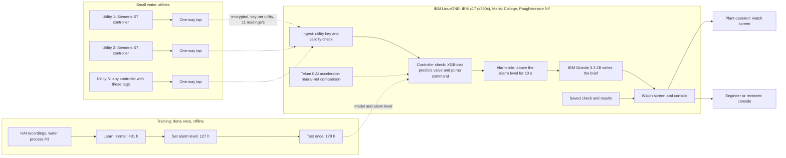

# Architecture

How a water utility's controller, the IBM LinuxONE server and people connect, and where every piece of data goes.

In the diagram, solid boxes were **built and run on LinuxONE** for the datathon. Dashed boxes are the **deployment design** that a real rollout adds. Several utilities can share the one server.

*Figure 1. Everything that thinks (the model, the alarm rule and Granite) runs on the one LinuxONE server. Utilities only send readings; nothing on the server can write back to a utility's controller.*

The same architecture as a diagram GitHub draws from text:

## Step by step

| # | Step | What happens | Status |
|---|---|---|---|
| 1 | Utility controller | The Siemens S7 controller measures the upper tank's level, flow and pressure, knows its setpoints and demand, and decides the pump speed and valve position. | Existing equipment |
| 2 | One-way tap | Copies the 11 readings once a second. It has no way to write to the controller. | Deployment design |
| 3 | Encrypted link to LinuxONE | Each utility has its own key, so a utility can only send its own data. | Deployment design |
| 4 | Controller check | Predicts the valve and pump command the controller *should* give, and scores the gap to what it *did* give. | Built |
| 5 | Alarm rule | Alarms only when the gap stays above the alarm level for 10 seconds. | Built |
| 6 | IBM Granite brief | Turns the alarm's facts into a short brief with first steps, on the same server. | Built |
| 7 | Watch screen and console | The operator's alarm banner, readings, brief and steps; the engineer's check performance, traces and recompute button. | Built |

## Where the data goes

| From → to | What travels | How often | Protection | Status |
|---|---|---|---|---|
| Utility controller → one-way tap | 11 readings: tank level, high and low setpoints, flow, pressure, four demand values, valve command, pump command | every second | one-way copy; the tap cannot write to the controller | Deployment design |
| One-way tap → LinuxONE | the same readings with the utility ID and time (about a dozen numbers, a few hundred bytes) | every second | encrypted link; a key per utility | Deployment design |
| HAI recordings and simulated attack files → LinuxONE | recorded readings standing in for the tap feed | once, stored on the server | public dataset (CC BY-SA 4.0); attack files made from it | Built |
| Replay server → controller check | one reading per second, scored causally (only the current and earlier seconds) | every second | stays inside the server | Built |
| Alarm → IBM Granite | only the alarm's facts: which command, how far off, when | once per alarm | Granite runs on the same server; no outside AI service | Built |
| Server → people | watch screen and console: banner, readings, brief, first steps, check performance | live | served on the server's localhost (port 38891); reached through an SSH tunnel with a key | Built |
| Results → GitHub Pages | static copies with the saved LinuxONE results; no live data | when results change | the pages cannot control anything | Built |

## What actually ran on LinuxONE

For the datathon there is no live tap. Recordings from a real Siemens-controlled testbed (HAI), plus two simulated attack files, stand in for it. Everything else ran on our LinuxONE server.

*Figure 2. The model was trained, calibrated and tested on IBM LinuxONE, and Granite wrote its briefs there. The replay server scores every second on LinuxONE; the GitHub Pages copies show the saved LinuxONE results and do not run the model in the browser.*

| Part (in the official Jupyter Lab ML container on the IBM z17) | What it does |
|---|---|
| `notebooks/00_environment_check` | Confirms s390x, machine type 9175 and the Telum II AI accelerator |
| `notebooks/01_hai_water_process` | The water process, its readings and its attacks; fixes label problems |
| `notebooks/02_controller_check` | Trains, calibrates and tests the controller check once; runs the Telum comparison; saves results |
| `notebooks/03_incident_brief` | IBM Granite 3.3 2B (big-endian build) writes a brief for a real detection, in 69 s |
| `demo/replay_server.py` | Plays a recording second by second as the tap feed, scores it with the saved check, has Granite write the brief, and serves the watch screen (`/`) and console (`/console`); "Recompute on IBM LinuxONE" re-runs notebook 02 (about 70 s) |

`dashboard/build_data.py` collects the results into `dashboard/data.json`; the console and the GitHub Pages copies are built from that file.
