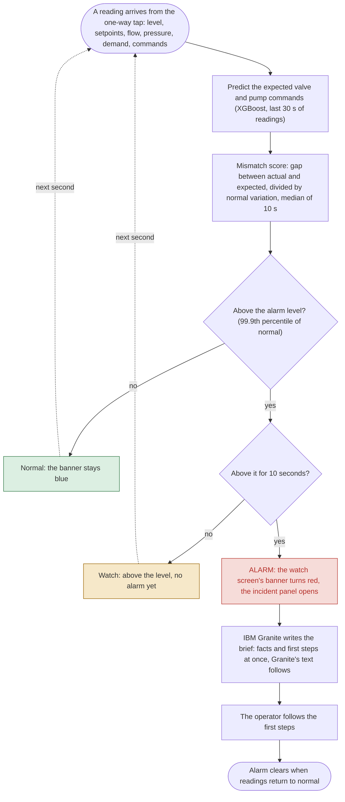

# Solution flowchart

What happens to every reading, every second.

*Figure 3. One pass per reading. The first steps are the ones the watch screen shows with every alarm.*

The same flowchart as a diagram GitHub draws from text:

## The steps

| Step | What happens | Why |
|---|---|---|
| A reading arrives | 11 values every second: tank level, high and low setpoints, flow, pressure, four demand values, valve command, pump command | This is everything the controller itself uses |
| Predict | XGBoost predicts the valve and pump command from the last 30 seconds of readings and the controller's own command 30 seconds ago | Learned from 401 hours of normal operation only |
| Mismatch score | The larger gap between actual and expected command, in units of normal variation, as a 10-second median | One number per second that rises when a command is changed or replayed |
| Above the alarm level? | Compares the score with the 99.9th percentile of the score on normal data | Alarm level set on 127 hours of held-out normal data |
| Above it for 10 seconds? | Only a sustained gap raises an alarm | Stops brief blips from alarming; this hold is why the median time to alarm is 20 s |
| Alarm | The watch screen's banner turns red and the incident panel opens | The operator sees it at once, beside the usual screen |
| Granite brief | The alarm's facts and first steps show at once; IBM Granite 3.3 2B's explanation follows | Runs on the same server from the alarm's facts only; the AI has no controls |
| Operator acts | Switch the affected pump or valve to manual and check the tank level directly; disconnect the controller from the internet and remote-access tools; change default and shared passwords; compare the controller program with the last known-good copy; report to CISA and the local FBI field office | People decide every step |
| Alarm clears | When readings return to normal | The banner goes back to blue |
